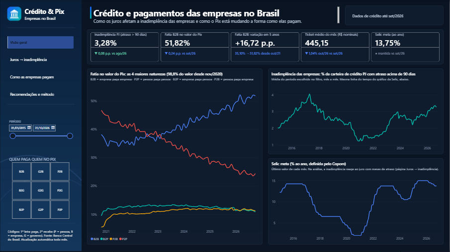
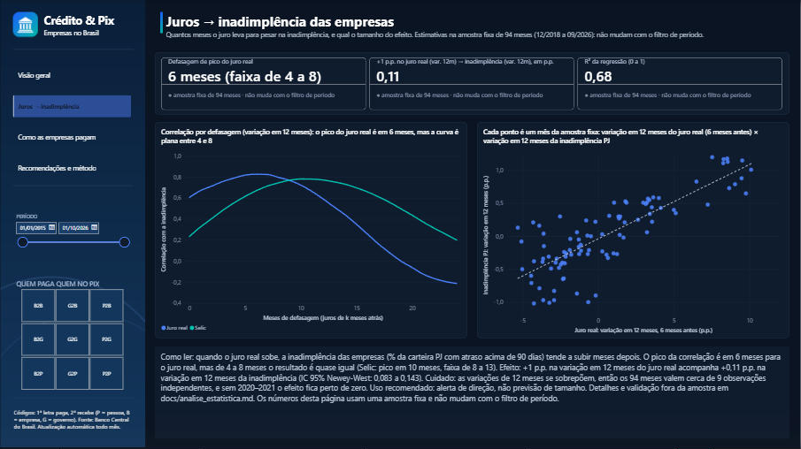
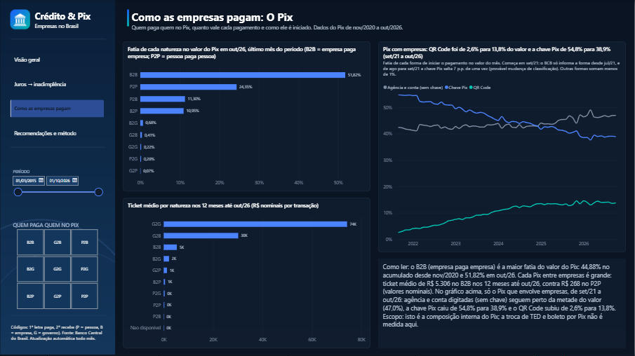
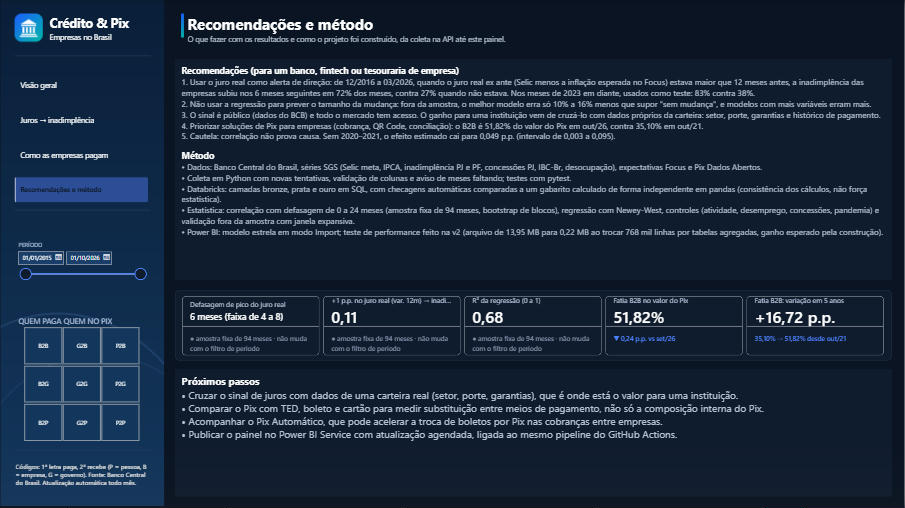

# Crédito e pagamentos das empresas no Brasil

[](https://github.com/Ig0rMendes/bcb-credito-pagamentos/actions/workflows/testes.yml)
[](https://github.com/Ig0rMendes/bcb-credito-pagamentos/actions/workflows/pipeline_mensal.yml)

> **Pergunta de negócio:** como os juros afetam a inadimplência das empresas, e como o Pix está mudando a forma como elas pagam?

## Resultados principais

Todos os números vêm dos dados do Banco Central (coleta de 20/11/2026; séries de controle em 22/11/2026). As tabelas gold foram conferidas contra cálculos independentes em pandas e em SQL local (DuckDB): isso garante que **os cálculos estão certos**, não que a relação estatística é forte. A força da relação está avaliada à parte, abaixo e em [`docs/analise_estatistica.md`](docs/analise_estatistica.md).

**Inadimplência PJ** = percentual da carteira de crédito a empresas com atraso acima de 90 dias (SGS 21083).

- **Os juros chegam na inadimplência com atraso, mas a defasagem é uma faixa.** Com as duas séries em variação de 12 meses, a correlação com o juro real é máxima em 6 meses (r = 0,83), mas de **4 a 8 meses** o resultado é quase igual. Para a Selic, o pico é em 10 meses (faixa de 8 a 13).
- **A amostra é menor do que parece.** Variações de 12 meses de meses vizinhos repetem 11 meses de dados: os 94 meses (12/2018 a 09/2026) valem cerca de **9 observações independentes**. Por isso o intervalo de 95% do r, por bootstrap de blocos, vai de 0,44 a 0,92.
- **Tamanho do efeito (com unidades):** +1 p.p. na variação em 12 meses do juro real acompanha **+0,113 p.p.** na variação em 12 meses da inadimplência PJ seis meses depois (Newey-West: 0,083 a 0,143; R² = 0,68).
- **A relação resiste a controles, mas depende da pandemia.** Prevendo a mudança da inadimplência nos 6 meses seguintes, com atividade (IBC-Br), desemprego, concessões de crédito e um indicador da pandemia no modelo, o juro real ex ante continua relevante (0,080 p.p.; 0,037 a 0,123). Sem os meses de 2020–2021, o efeito cai para 0,049 p.p. (0,003 a 0,095).
- **Como previsão de tamanho, ajuda pouco.** Fora da amostra (janela expansiva, teste a partir de 2022, 2023 ou 2024), só o modelo mais simples erra menos que "a inadimplência vai ficar como está", e por 10% a 16%. Modelos com mais variáveis erram mais.
- **Como alerta de direção, funciona.** Quando o juro real ex ante estava maior que 12 meses antes, a inadimplência subiu nos 6 meses seguintes em **72%** dos meses (contra 27% sem o alerta), de 12/2016 a 03/2026. Só nos meses de 2023 em diante: 83% contra 38%.
- **Pix: o B2B (empresa paga empresa) é a maior fatia do valor** e passou de **35,10%** (out/21) para **51,82%** (out/26) do valor do mês. No acumulado desde nov/2020, o B2B é 44,88% e o P2P, 30,00%.
- **Escopo do Pix:** a análise mostra a **composição interna** do Pix (quem paga quem e como). Ela não compara o Pix com TED, boleto ou cartão, então não mede substituição entre meios de pagamento.

### Recomendações

1. **Usar o juro real como alerta de direção**, não como previsão de tamanho: quando ele está acima do nível de 12 meses antes, esperar alta da inadimplência PJ nos meses seguintes (72% de acerto no histórico; 83% no período de teste) e apertar a análise de crédito.
2. **Não usar a regressão para provisionar valores:** fora da amostra, o ganho sobre a previsão ingênua é pequeno e instável.
3. **O sinal é público:** todo o mercado tem os dados do BCB. O valor para uma instituição está em combiná-lo com dados próprios da carteira (setor, porte, garantias, histórico de pagamento), o que este projeto não tem.
4. **Priorizar soluções de Pix para empresas** (cobrança, QR Code, conciliação): o B2B já é a maior parte do valor, e o QR Code no Pix com empresas subiu de 2,6% para 13,8% do valor (set/21 a out/26).

## Etapas

| Etapa | O que faz | Status |
|---|---|---|
| 1. Coleta via API | Python busca séries do Banco Central (APIs REST e OData, JSON), valida e salva tabelas limpas | ✅ concluída |
| 2. Nuvem | Databricks (Unity Catalog, Delta): volume → bronze → silver → gold, tudo em SQL e conferido | ✅ concluída |
| 3. Painel | Power BI com análise de defasagem juros → inadimplência, Pix por natureza, recomendações e teste de performance | ✅ concluída |

## Fontes de dados (públicas)

| Série | Código SGS | Unidade |
|---|---|---|
| Meta Selic definida pelo Copom | 432 | % a.a. |
| IPCA – variação mensal | 433 | % a.m. |
| Inadimplência da carteira de crédito – Pessoas jurídicas – Total | 21083 | % |
| Inadimplência da carteira de crédito – Pessoas físicas – Total | 21084 | % |
| Concessões de crédito – Pessoas jurídicas – Total | 20632 | R$ milhões |
| IBC-Br com ajuste sazonal (controle: atividade) | 24364 | índice |
| Taxa de desocupação – PNAD Contínua (controle: desemprego) | 24369 | % |
| Expectativa de IPCA para 12 meses – Focus, mediana suavizada (juro real ex ante) | API Expectativas | % |
| Estatísticas de transações Pix (por natureza: P2P, P2B, B2B...) | API Pix Dados Abertos | R$ e quantidade |

Fontes: [SGS – Banco Central](https://www3.bcb.gov.br/sgspub) e [Portal de Dados Abertos do BCB](https://dadosabertos.bcb.gov.br).

## Como rodar

```bash
pip install -r requirements.txt
python src/coletar_dados.py   # coleta (precisa de internet)
pytest                         # testes das transformações (não precisam de internet)
python src/coletar_controles.py    # séries de controle (IBC-Br, desemprego, Focus) -> data/processed/controles_mensais.csv
python src/analise_estatistica.py  # correlação, bootstrap, controles e validação fora da amostra -> docs/analise_estatistica.md
```

O `pytest` também roda os SQLs de `sql/` localmente com DuckDB (um banco que funciona dentro do Python) e confere os resultados, antes de levá-los ao Databricks.

No Databricks: envie `series_sgs_longo.csv`, `pix_detalhado.parquet` e `gabarito.csv` para o volume `workspace.bcb.landing` e rode os arquivos de `sql/` em ordem.

## Estrutura

```
src/coletar_dados.py        # coleta, validação e transformação
src/gabarito.py             # valores esperados das checagens do Databricks, recalculados a cada coleta
src/coletar_controles.py    # séries de controle da análise estatística (fora do pipeline do Databricks)
src/analise_estatistica.py  # defasagem, bootstrap, tamanho efetivo, controles e validação fora da amostra
docs/analise_estatistica.md # relatório gerado pelo script acima
docs/performance.md         # teste de performance do Power BI (antes x depois)
powerbi/v3_terminal.pbip    # painel final: Power BI Project (relatório PBIR + modelo TMDL)
powerbi/v2_otimizada.pbix   # versão anterior, de fundo claro (cópia de segurança)
powerbi/tema/               # tema JSON e fundo do painel (gerado em Python)
docs/img/                   # capturas das páginas do painel
tests/                      # testes automatizados (pytest), incluindo o SQL rodado localmente com DuckDB
sql/                        # SQL do Databricks, na ordem de execução
  01_estrutura.sql          #   schema e volume no Unity Catalog
  02_bronze.sql             #   arquivos do volume -> tabelas bronze (com colunas de auditoria)
  03_checagens_bronze.sql   #   confere as tabelas contra os números do Python
  04_silver.sql             #   indicadores mensais (pivot, IPCA 12m, juro real) e Pix com nomes claros
  05_gold.sql               #   defasagem juros -> inadimplência, correlação por defasagem, Pix por natureza e forma
  06_checagens_silver_gold.sql  # confere silver e gold contra cálculos independentes
data/raw/                   # JSON original da API (auditoria)
data/processed/             # CSV/Parquet limpos, prontos para o Databricks
```

## Decisões de tratamento

- **Séries diárias → mensais:** a meta Selic é diária; uso o último valor de cada mês.
- **Limite da API:** consultas de séries diárias são quebradas em blocos de até 10 anos.
- **Mês incompleto fora:** o mês corrente é descartado em todas as séries (a meta Selic de novembro seria só o valor do dia da coleta).
- **Pix – uma requisição só:** na API `EstatisticasTransacoesPix`, o parâmetro `Database=AAAAMM` funciona como "a partir de": `Database=202208` devolve de 2022-08 até o último mês publicado. Por isso o script faz **uma** requisição (`Database=202011`) e usa a coluna `AnoMes` de cada linha como o mês. (A 1ª versão pedia mês a mês e repetia os mesmos meses em cada resposta. Descobri isso conferindo os JSONs salvos em `data/raw/`.)
- **Pix – resumo:** valor e quantidade por mês e natureza (P2P, P2B, B2B...) e participação de cada natureza no valor total do mês.
- **Pix – nov/2020:** o Pix começou a funcionar no meio do mês, então nov/2020 é um mês parcial e não deve ser comparado com os demais.
- **Pix em Parquet para a nuvem:** o `pix_detalhado.csv` tem ~80 MB e o upload pelo navegador falhava. O script também grava `pix_detalhado.parquet` (~12 MB, formato colunar e comprimido, com os tipos das colunas). É ele que vai para o Databricks.
- **Arquivos grandes fora do Git:** o JSON do Pix (~200 MB) e os arquivos `pix_detalhado.*` estão no `.gitignore` e são gerados de novo pelo script.
- **JSON original preservado** em `data/raw/` para que qualquer número possa ser auditado.

## Camadas no Databricks (arquitetura medalhão)

| Camada | Tabela | Para que serve |
|---|---|---|
| Bronze | `bronze_sgs`, `bronze_pix` | Arquivos como vieram, com tipos fixados e colunas de auditoria |
| Silver | `silver_indicadores_mensais` | Um mês por linha: Selic, IPCA, IPCA 12m, juro real, inadimplência PJ/PF, concessões PJ |
| Silver | `silver_pix` | Pix com nomes claros, tipo de pagador/recebedor e marcação de mês parcial |
| Gold | `gold_defasagem_juros_inadimplencia` | Selic e juro real de 3 a 12 meses antes, ao lado da inadimplência atual |
| Gold | `gold_correlacao_defasagem` | Correlação juros × inadimplência PJ para defasagens de 0 a 24 meses |
| Gold | `gold_pix_natureza_mensal` | Valor, quantidade, ticket médio e participação por natureza, mês a mês |
| Gold | `gold_pix_empresas_forma_iniciacao` | Como empresas pagam e recebem (chave, QR Code, Pix Automático...) |

### Decisões da silver e da gold

- **Empresa vem da natureza, não de `PAG_PFPJ`:** nos dados do BCB, `PAG_PFPJ = 'PJ'` inclui o governo. Por isso o tipo de pagador e recebedor é lido da natureza (P = pessoa, B = empresa, G = governo).
- **IPCA em 12 meses composto:** inflação acumulada é produto, não soma. Em SQL: `exp(soma dos logaritmos) - 1`.
- **Juro real ex post (aproximação):** `(1 + Selic) / (1 + IPCA 12m) - 1`, comparando a meta Selic do mês com a inflação dos 12 meses anteriores.
- **Correlação em duas bases:** em nível e em variação de 12 meses. Séries com tendência longa ficam correlacionadas "de graça" no nível; a variação remove essa tendência. Se as duas apontam defasagens próximas, o resultado é mais confiável.
- **Mesma amostra para todas as defasagens:** todas as correlações usam os mesmos 94 meses (dez/2018 a set/2026), para serem comparáveis entre si.
- **Formas de iniciação do Pix:** só os códigos com descrição nos manuais do BCB foram traduzidos; `APDN` e `APES` ficam marcados como "descrição a confirmar".
- **Gabarito automático:** as checagens (`sql/03` e `sql/06`) não têm números escritos à mão. A cada coleta, `src/gabarito.py` recalcula com pandas, por outro caminho, os valores que as tabelas devem ter e grava `gabarito.csv`, que vira a tabela `bronze_gabarito`. O SQL mede as tabelas e compara. Datas também não são fixas: o "mês de referência" é o último com inadimplência publicada.
- **Tolerâncias:** contagens precisam bater exatamente; decimais têm tolerância pequena, porque motores diferentes arredondam a última casa de formas diferentes. A soma do Pix usa tolerância proporcional (1 parte em 1 trilhão do total), porque somar centenas de milhares de decimais em ordens diferentes muda os últimos centavos.
- **Trava nas checagens:** se qualquer checagem falhar, `sql/03` e `sql/06` param com erro (`raise_error`) e dizem qual falhou. No pipeline automático, isso impede que silver e gold sejam reconstruídas em cima de dados com problema. O resultado completo fica nas views `vw_checagens_bronze` e `vw_checagens_silver_gold`.
- **Testes das checagens:** o `pytest` confere que as checagens passam, que todo item do gabarito é conferido pelo SQL e que elas **param com erro** quando os dados estão incompletos (teste negativo).
- **Cuidado na leitura:** correlação não prova causa. Juros e inadimplência respondem ao ciclo econômico como um todo; os controles e a validação fora da amostra estão em [`docs/analise_estatistica.md`](docs/analise_estatistica.md).

## Automação

O pipeline roda sozinho todo dia 28 (ou num clique, na aba **Actions**):

```
GitHub Actions (pipeline_mensal.yml)
  1. testa as transformações
  2. coleta os dados nas APIs do BCB e gera o gabarito
  3. testa o SQL com os dados novos (DuckDB)
  4. envia os arquivos para o volume do Databricks (Databricks CLI)
  5. dispara o Job do Databricks  ──►  carregar_bronze → checar_bronze → silver → gold → checar_silver_gold
     e só marca sucesso se o Job terminar com SUCCESS
```

- **Por que a coleta roda no GitHub, e não no Databricks:** a versão gratuita do Databricks só acessa um conjunto restrito de sites. Um workflow de teste (`teste_conexao_bcb.yml`) confirmou antes que as APIs do BCB respondem aos servidores do GitHub, incluindo o download completo do Pix.
- **O Job lê o SQL direto do GitHub** (branch `main`): o que roda na nuvem é sempre a versão versionada, sem copiar e colar.
- **Disjuntor:** se uma checagem falhar, o Job para antes de reconstruir silver e gold, e o workflow do GitHub fica vermelho com o link da execução.
- **"Terminar" não é "dar certo":** o workflow confere explicitamente se o Job terminou com `SUCCESS`, porque a CLI pode encerrar sem erro mesmo quando o Job falhou.
- **Segurança:** o token do Databricks fica nos *secrets* do GitHub (nunca no código), tem validade de 90 dias e só os escopos `files` e `jobs` (privilégio mínimo). Renovar antes de vencer: Settings → Developer → Access tokens no Databricks, e atualizar o secret `DATABRICKS_TOKEN` no GitHub.
- **Auditoria:** cada execução guarda gabarito, séries e o resultado do Job como artefato por 90 dias.
- **Testes a cada push** (`testes.yml`): sem os dados, os testes do SQL são pulados e os demais rodam.

## Painel no Power BI

Arquivo principal: [`powerbi/v3_terminal.pbip`](powerbi/v3_terminal.pbip), um **Power BI Project** (relatório em PBIR e modelo em TMDL, ou seja, texto que o Git consegue comparar linha a linha). Conecta nas tabelas gold do Databricks (conector Azure Databricks, modo Import). A versão anterior, de fundo claro, fica intocada em [`powerbi/v2_otimizada.pbix`](powerbi/v2_otimizada.pbix) como cópia de segurança.






| Página | O que mostra |
|---|---|
| Visão geral | Cinco KPIs com a variação contra o mês anterior (inadimplência PJ, fatia B2B do Pix, fatia B2B em 5 anos, ticket médio do mês, Selic), fatia de cada natureza no valor do Pix e dois gráficos empilhados, com a mesma linha do tempo: inadimplência PJ e Selic |
| Juros → inadimplência | Correlação por defasagem (0 a 24 meses), dispersão juro real 6 meses antes × inadimplência com linha de tendência, e cartões com defasagem de pico (com faixa), efeito (com unidades) e R² |
| Como as empresas pagam | Fatia de cada natureza no valor do Pix no último mês, ticket médio por natureza nos últimos 12 meses e formas de iniciação do Pix que envolve empresas (desde set/21) |
| Recomendações e método | Recomendações com os números do teste histórico da regra de alerta e resumo técnico do projeto |
| Teste de performance | Página usada nas medições do Performance Analyzer (oculta na navegação; fica no arquivo como documentação) |

### Decisões do painel

- **Visual "terminal financeiro escuro" (v3):** conteúdo em `#0B1424`, cartões em `#111C30` com borda fina `#22314A`, números em branco e cor só quando ela tem significado. O menu lateral (degradê `#0B1F3A` → `#14365D`, arcos e divisórias) é idêntico ao da v2, conferido pixel a pixel; só o logotipo mudou, para um prédio de banco genérico desenhado em Python. Tema em [`powerbi/tema/tema_bcb_terminal.json`](powerbi/tema/tema_bcb_terminal.json) e fundo gerado por [`powerbi/tema/gerar_fundo.py`](powerbi/tema/gerar_fundo.py) (`--claro` refaz o fundo da v2).
- **KPIs com variação:** cada cartão mostra rótulo, valor e uma linha de variação com seta. A cor diz se a mudança é **boa ou ruim**, não para onde a seta aponta: inadimplência subindo é vermelho e caindo é verde; fatia B2B e ticket médio usam azul neutro (mudança de composição não é boa nem ruim); mudança da Selic é âmbar e, sem mudança, aparece "● mantida" em cinza; variações menores que 0,005 aparecem como "● estável". Os cartões estatísticos (defasagem, efeito, R²) **não** ganham variação inventada: a terceira linha diz que usam a amostra fixa de 94 meses.
- **Medidas que respeitam o período:** as medidas da pasta `KPIs – variação` usam o último mês com dado dentro do período escolhido e comparam com o mês anterior a ele. Conferidas contra um cálculo independente em pandas no período completo e com o período terminando em jun/2026. O ticket médio do cartão é o do último mês (R$ nominais), a mesma base da linha de variação.
- **Filtros e a análise estatística:** os cartões de defasagem, efeito e R² usam sempre a amostra fixa de 94 meses, de propósito, e dizem isso no próprio cartão ("não muda com o filtro de período").
- **Sem eixo duplo:** Selic e inadimplência ficam em dois gráficos empilhados com a mesma linha do tempo. Com dois eixos, a escala escolhida muda a impressão de quanto as séries "andam juntas".
- **Defasagem como faixa:** o cartão mostra "6 meses (faixa de 4 a 8)", calculado em DAX sobre `gold_correlacao_defasagem` (defasagens com correlação até 0,05 abaixo do pico), igual ao Python.
- **Barras coerentes com os KPIs:** a fatia por natureza é a do último mês do período (B2B = 51,82%, igual ao cartão) e o ticket por natureza é o dos últimos 12 meses, com o mês no título (medidas de título dinâmico).
- **Forma de iniciação desde set/21:** o BCB só informa a forma desde jul/21, e de ago para set/21 a chave Pix salta 7 p.p. de uma vez (provável mudança de classificação). `MANU` aparece como "Agência e conta (sem chave)".

- **Modelo estrela:** tabelas de dimensão `dCalendario` (um dia 1 por mês) e `dNatureza` filtram as tabelas gold. A data/hora automática do Power BI fica desligada, porque ela cria uma tabela de calendário escondida para cada coluna de data.
- **Números calculados no modelo, não digitados:** a defasagem de pico vem da tabela `gold_correlacao_defasagem`; o efeito e o R² vêm de uma regressão feita em DAX (`LINESTX`) sobre a mesma amostra de 94 meses (coluna `na_amostra_comum` da gold). Eles batem com o Python: 6 meses, 0,113 e 0,68.
- **Performance (medida na v2; a v3 usa o mesmo modelo):** a versão ingênua (v1) importava a tabela detalhada do Pix (`silver_pix`, 768 mil linhas); a v2 importa só as tabelas gold, já agregadas (~3 mil linhas). Resultado: arquivo de 13,95 MB para 0,22 MB (63× menor), carga de ~70 s para ~10 s e o visual mais lento de 919 ms para 508 ms. O tempo de consulta DAX nunca foi o gargalo; o que pesa é desenhar os visuais. O ganho era esperado pela construção (trocar linhas detalhadas por tabelas agregadas); o teste documenta o tamanho dele. Medições completas em [`docs/performance.md`](docs/performance.md).
